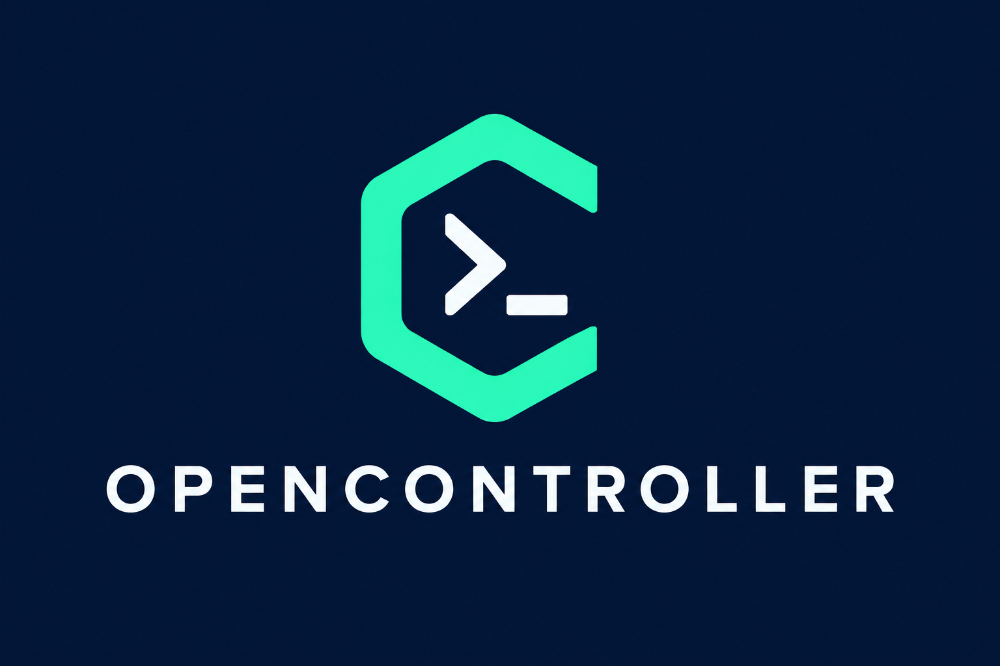

# OpenController



**A desktop interface for the OpenClaw and Hermes agent CLIs.**

[MIT license](LICENSE) · [Contributing](CONTRIBUTING.md) · [Report a bug](https://github.com/TrustlessMike/opencontroller/issues)

An experimental Electron app that launches locally installed agent CLIs and
turns their output into a readable conversation. The source includes config
import, provider selection, sessions, skills and tool-output views.

## Status

This is a source-build prototype. The previous npm-install instructions did not
match the repository: use the checkout below. macOS packaging scripts exist;
Windows and Linux packages are not configured or verified here. The macOS
packager currently references `build/icon.icns`, which is not included; the
README artwork is not a replacement for that application icon. No packaged
release is promised by this README.

## Run from source

Install Node.js 22 LTS and npm, then:

```sh
git clone https://github.com/TrustlessMike/opencontroller.git
cd opencontroller
npm ci
npm run dev
```

OpenClaw or Hermes must be installed and configured separately for real agent
runs. Their providers may use remote services and incur their own charges.
OpenController is an independent interface, not an official client of either.

On first launch the app can import existing configuration from `~/.openclaw`
or `~/.hermes`. To inspect the interface without importing those settings:

```sh
OPEN_CONTROLLER_SKIP_OPENCLAW_AUTO_IMPORT=1 npm run dev
```

Do not commit imported configuration or real credentials. The app executes
agent processes with the permissions of the account running it.

## Development

```sh
npm run typecheck
npm run build
```

The `e2e/` directory contains Playwright/Electron tests. Review the chosen test
before running it: `real-roundtrip.spec.ts` is intended for real agent runs.

Useful entry points:

- `src/main/agents/`: OpenClaw and Hermes process adapters.
- `src/main/import/`: configuration discovery and import.
- `src/renderer/src/components/`: chat, settings, sessions and skills views.
- `src/shared/types.ts`: shared data types.

## Where to help

Reproducible CLI compatibility reports, clearer onboarding and packaging work
are welcome. Keep changes focused and document the environment you tested.
See [CONTRIBUTING.md](CONTRIBUTING.md).

## License

[MIT](LICENSE). Third-party tools and dependencies retain their own licenses.
